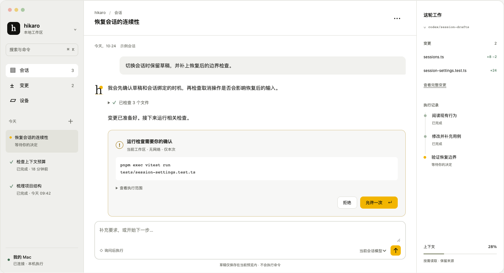
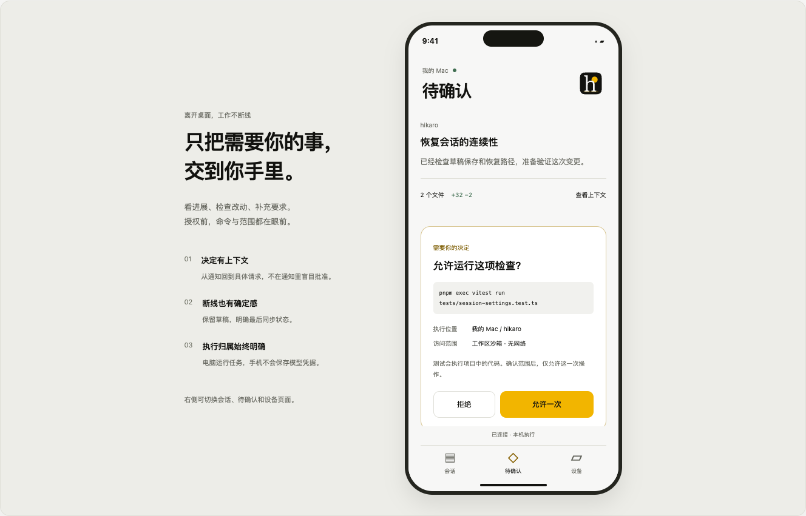
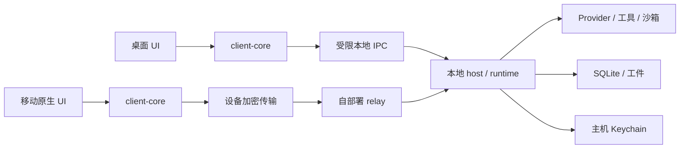

# Hikaro 桌面与移动端重启方案

2026-10-18 · 产品及工程提案 · 本轮交付为文档、交互草案与品牌候选

**建议先把核心编程闭环与客户端协议补齐，再启动桌面工作台，最后交付移动控制器。** 一个本地 host 拥有执行权；桌面让人深入工作，手机让人查看进展、确认请求和补充指令。两端共享协议、状态归并与故障语义，不共用一套缩小的页面。

[打开可交互草案](design/client-reboot/index.html) · [桌面截图](design/client-reboot/desktop.png) · [手机截图](design/client-reboot/mobile.png) · [品牌修订候选](../brand/explorations/2026-10/README.md)



## 事实边界

当前安装与发布范围仍是 CLI / 全屏 TUI、独立 core、Pi 双向接入和可选 relay。此前 Electron / Expo 实验、共享客户端状态包、专用移动测试已经删除。**本方案没有恢复这两个客户端，没有新增真实 remote UI，也没有部署 relay、创建 EAS 项目或发布应用。** 示例会话、diff、检查结果与模型选择都是模拟，不代表本次代码改动。

依据为 [README](../README.md)、[TODO](../TODO.md)、[架构](architecture.md)、[远程连接](remote.md)、`packages/protocol/src/index.ts`、`packages/protocol/src/client.ts`。本方案是本轮检查时的基线；并行完成的核心功能以 TODO 和本轮验收记录为准，不能用本文替代实现账本。

前一轮核心基线已补充：当前工作区全部会话标题/ID 的分页搜索、300ms 合并且串行的草稿自动保存/进程崩溃恢复、包含 system/工具 schema/图片与输出预留的完整请求预算，以及确定性 10k 事件/流式 harness。消息正文全文检索、精确 tokenizer、自动压缩、跨重启预算和待发队列恢复仍未完成。模型目录延迟加载后，30 次启动 p95 从 405.24ms 降至 324.81ms，仍未达到既定 200ms 门槛；RSS p95 为 81.39MiB。这是 TUI 实测，不能外推成未来 GUI 成绩。原始口径见 [harness 与性能记录](harness-performance.md)。

现有 protocol v2 已增量加入 `hello` 能力协商，原有 create/list/current/resume/fork/compact、messages/events 分页、prompt/steer/cancel、approval.respond、client.detach。`ProcessClient` 导入 Node 子进程与 Buffer，不能直接打进 React Native。TUI 有模型选择、重命名、删除、导出等入口，不代表远程协议已暴露这些能力。

## C0 第一切片：已实现，共享协议闭环

`packages/client-core/` 已落地纯 TypeScript 执行状态层，并用独立 ES2023、无 Node/DOM ambient types 的配置验证可移植性；尚未创建 Tauri/Expo 应用，也没有接上生产 relay 客户端。

- `hello` 为兼容新增的 v2 控制方法。返回真实方法集合、快照方法、全库单调事件序号语义、scope revision、1 MiB 帧上限、禁止自动重放与 run ID 仅能从已观察事件获知的限制。旧 ready/method 行为保留。
- `session.current` 新增通知 revision；event、approval、approval.resolved 帧使用同一 scope 的连续 revision。它与 SQLite 全库自增的事件 seq 是两个概念，不会把并发会话占用的 seq 当作丢包。
- 状态层处理 scope/session 隔离、事件去重、revision 缺口、连接 epoch、快照期间有界缓冲与水位之后的补齐。远程响应比通知晚到时，已经解决的审批不会被旧快照重新激活。
- 断线/超时将尚未收到回复的命令标为 unknown；恢复快照不会把它变成成功，也不会自动再次发送。普通响应的 acknowledged 仅表示收到回复，不能声称任务已完成。
- 缓存上限：64 个事件摘要、100,000 字符输出、64 个审批且总序列化大小不超过 1 MiB、128 个缓冲通知且总计不超过 1 MiB、64 个本地回执。未解决的变更回执不能被容量淘汰；容量不足明确拒绝。
- `ProcessClient.observe` 提供有序原始帧观察，不改变原有 request/subscription 路由。真实 serveRpc + SQLite + 离线 demo 已和新状态层对接，测试含第二会话占用全库序号、重连与 RPC 图片格式拒绝。

还未完成：持久化 command receipt 查询与 payload digest 冲突检查、host instance ID、快照内 runId、完整历史/附件分页、mobile raw transport adapter、原生客户端生命周期与平台验收。来源及使用边界见 [client-core contract](../packages/client-core/README.md)。核心自动压缩/附件输入的本轮更新继续以 TODO 和 validation 为准，不用本草案的模拟 diff 充当实现证据。

## 产品范围与主流能力矩阵

优先级：P0 = 每日编程必须可信；P1 = 主流工作流完整；P2 = 稳定后扩展。已有代码表示路径存在；生产账号、跨端行为和真实平台验收另算。

| 能力 | 当前核心/TUI 基础 | 桌面交付 | 移动交付 | 优先级与依赖 |
| --- | --- | --- | --- | --- |
| 项目与工作区 | 工作目录、规范路径、按工作区权限 | 最近项目、目录选择、可信状态；一窗口一主机上下文 | 选择已配对主机上的项目；不能任意输入主机路径 | P0，host 明确 workspace identity |
| Provider 与模型 | pi-ai、多 provider、自定义 endpoint、Keychain | 登录、模型搜索、active/default 区分、参数能力约束 | 读取并选择主机已配置模型；首次登录留在主机 | P0，补 protocol，不传密钥 |
| 会话管理 | 新建、恢复、分支、命名、删除、分页；全工作区标题/ID 搜索 | 搜索、固定、分组、导出、删除确认与恢复策略 | 最近会话、搜索、重命名、归档；删除放次级操作 | P0 基本操作；消息正文搜索/固定/归档 P1 |
| 输入与草稿 | 多行、补全；300ms 合并自动保存，已保存稿可崩溃恢复 | 自动保存、输入法、附件、文件引用、拖入文件 | 原生输入、图片附件、草稿；离线明确未发送 | P0 草稿；附件协议 P1 |
| 运行生命周期 | 流式、取消、steer、租约、任务事件 | 新输入排队/补充/停止语义明确；运行归属可见 | 发起、补充、停止与结果确认；不能误触重新运行 | P0，补状态与幂等语义 |
| 权限 | workspace Ask/Auto/Full；RPC 不继承 TUI 模式 | 显示来源、参数、cwd、网络/文件范围；允许一次/拒绝 | 必须进入完整请求页；不从锁屏直接授权 | P0，host 判定，GUI 不能自行扩大权限 |
| 上下文 | 完整请求预算、有界历史、分支、手动压缩、来源文件 | 可见预算、自动压缩提示、摘要回看、约束保留 | 简明预算和压缩状态；完整摘要可展开 | P0 精确计量/自动压缩待补，摘要质量需人工评估 |
| 文件与代码 | 读写/编辑/rg、安全 helper、并发检查 | 文件树、引用跳转、语法高亮、变更 diff | 路径与片段、统一 diff、复制；大 diff 延迟加载 | P0 diff；完整编辑器 P2 |
| Git 工作流 | status/diff 等基础工具 | 分支/worktree 状态、已有改动分离、commit 预览 | 查看改动和检查；危险 Git 操作不默认暴露快捷动作 | P1；merge/push 必须可审查 |
| 终端与后台进程 | shell/PTY、后台进程、macOS 沙箱 | 可回看输出、清晰终止按钮、进程归属、退出选项 | 只读输出与停止；原生交互终端 P2 | P0 输出/停止；PTY 协议 P1 |
| 验证与测试证据 | 单测/真实 PTY/fixture、10k 事件/流式 harness | 检查命令、退出码、耗时、日志来源，不只绿勾 | 简明结果与失败定位 | P0；结果属于实际 operation |
| MCP / Skills / 插件 | 发现、工具、资源、权限基础 | 安装来源、启停、配置、能力与信任边界 | 查看状态；主机配置入口的受限投影 | P1；插件 UI 不能进入可信授权层 |
| 多 Agent / 任务 | 共享预算、子任务、DAG、租约 | 子任务树、合并结果、取消传播、并发上限 | 摘要与关键决策；完整编排 P2 | P1，对齐 core 语义 |
| 持久任务与定时 | 调度/恢复代码存在 | 创建/暂停/历史/失败处理；展示主机离线影响 | 通知与查看；创建能力延后 | P1，禁止结果不明时自动重放 |
| 远程与多设备 | 配对、加密、scope、撤销原型 | 配对/设备/主机生命周期 | 扫码、重连、离线草稿、设备安全存储 | P0 移动前置，独立安全验收 |
| 通知 | relay 有通用通知队列；无手机注册 | 本机完成/需确认；静默偏好 | 通用推送、通知跳转后重取权威状态 | P1，通知不能保证送达 |
| 历史与隐私 | SQLite、工件、本机凭据 | 按需导出、诊断脱敏、数据位置/删除 | 本地缓存上限、锁定、清除设备数据 | P0 缓存边界；备份/同步 P2 |
| 无障碍与国际化 | TUI 真机 IME/辅助技术仍待验收 | VoiceOver、键盘、缩放、高对比、减弱动态 | Dynamic Type、VoiceOver/TalkBack、大触控目标 | P0；不依赖颜色传达状态 |
| 分发与更新 | 现有 CLI 构建 | macOS 签名/公证、更新/回退、CLI 路径管理 | TestFlight 后 App Store；Android 独立验收 | P0 发布门槛；Windows/Linux 不默认等价支持 |

首发不需要：桌面完整 IDE、手机运行本地 Node agent、默认云端历史、强制账号、自动跨 provider 回退、让模型自行提高权限。先把“给任务 → 执行 → 决定 → 检查 → 下一步”做到可靠。

## 双端信息架构与关键交互

桌面采用三列：工作区/会话列表、当前任务、变更与执行证据。主要区域根据窗口缩放，右侧检查器可收起；窄窗口切成单栏，不能把授权按钮挤出可视范围。⌘K 聚合导航，⌘N 新会话，⌘Enter 提交；Esc 关闭当前层，运行取消需独立快捷键与清晰状态，避免和输入法冲突。拟议快捷键需要在真机与辅助技术环境验证，草案只实现 ⌘/Ctrl+K。

手机使用会话、待确认、设备三个顶层入口。通知进入具体请求；首次打开必须重取 requestId/runId/主机状态。授权页显示工具、完整命令、规范工作目录、网络/文件范围和原因，详情可展开但关键范围始终可见。表面上相同的“允许”必须指向同一个尚未处理的请求。请求过期、已由另一端处理或主机失联时禁用按钮并说明原因。



交互遵循本次调用的 apple-design：按下即反馈；所有动画可打断；手势与指针 1:1；侧栏从原处返回；系统字体用于正文，Literata 只用于品牌。黄色只用于待决策和关键动作，不把整片工作界面染黄。大区域保持实色，透明材质局限于确有悬浮关系的工具条。禁止无意义的空闲动画。

正式移动端优先用系统 sheet/菜单和平台 spring。默认临界阻尼、响应约 0.3–0.4 秒；只有拖拽或甩动释放才有少量回弹。`prefers-reduced-motion` / 系统减弱动态改为静态或短淡入淡出；降低透明度、增强对比独立响应。草案没有假装实现原生手势物理，只验证信息架构、按钮反馈、焦点、断线和页面状态。

## 技术选型与淘汰条件

### 桌面：先验证 Tauri 2 + Web UI + 本地 Node host

推荐先做 **2–3 个工程日的 Tauri 可行性实验**，不是立即承诺 Tauri 一定更快。现有 TypeScript core 保留，Rust 壳只负责系统集成、受限 IPC、签名/更新和进程监督。WebView 不获得任意 shell、fs、Node 或 Keychain 能力。组件使用团队熟悉的 React + TypeScript；无需把所有 TUI 组件抽成跨端 UI。

Tauri 官方支持外部 sidecar，并要求按目标架构打包；capabilities 可以限制各窗口可用的 IPC 权限。这能为轻量桌面壳提供基础，但**没有证明 Hikaro 的含 Node 总 RSS 会更低**。实验必须打包 Node、SQLite、`@napi-rs/keyring`、`node-pty`、安全 C helper 和签名资源，在没有开发环境的 macOS 上运行。不要要求最终用户装 Node/pnpm，也不要在 renderer 暴露通用 shell 插件。[Tauri sidecar](https://v2.tauri.app/develop/sidecar/) · [Tauri capabilities](https://v2.tauri.app/security/capabilities/)

实验过门槛：无外部 Node 的干净机器可启动；arm64 签名构建加载全部 native 资源；host 崩溃可见且不自动重放；流式/IME/窗口缩放稳定；下文桌面预算达标。达不到且定位在 WebView/sidecar 集成，改用 Electron；不要为更小安装包重写 agent core。

Electron 作为替代方案能降低现有 Node 集成摩擦，代价是需实测的包体和进程开销。若使用：`nodeIntegration:false`、`contextIsolation:true`、renderer sandbox、严格 CSP、导航限制，preload 按方法暴露窄接口；不透传 IPC 对象与任意参数，不加载不可信远程页面。每个 IPC 入口验证发送者与 schema。[Electron security](https://www.electronjs.org/docs/latest/tutorial/security)

### 移动：Expo / React Native 原生控制器

iOS 优先，Android 共用 headless 状态层与业务语义，分别验收系统导航、键盘、通知和 secure storage。使用 Expo Router 管导航，原生列表虚拟化长会话。对话不是 WebView；代码/diff 可用受限渲染器，禁止工具结果 HTML 获得应用桥接权限。大文件只取有界片段，手机不运行 host，也不保存 provider API key。

配对设备私钥、设备 bearer token 使用 `expo-secure-store`，不进 AsyncStorage/日志/截图。可启用敏感操作前本地生物识别，但它不能替代 host 的授权检查。SecureStore 的卸载与恢复行为在 iOS/Android 不同，且生物识别设置变化可能让密钥不可用；必须提供重新配对与主机撤销流程。[Expo SecureStore](https://docs.expo.dev/versions/latest/sdk/securestore/)

推送与完整原生能力从 development build 开始验收，不能把 Expo Go 当发布验证。后台 JS/推送不保证交付，不能靠手机长期保持 WebSocket 来保障任务执行。主机持续工作；回到前台时恢复状态。[Expo notifications](https://docs.expo.dev/push-notifications/what-you-need-to-know/)

以上来源检查于 2026-10-18；正式安装时按锁文件固定经兼容验证的版本，不在本提案中伪造已安装 SDK 版本。

## 共享 headless 层与协议补齐

目录规划：本轮已创建 `packages/client-core/`；下面其余新目录仍是提案：

```text
apps/desktop/                系统壳、窗口、托盘、更新、受限 IPC
apps/mobile/                 原生导航、输入、通知、扫码、缓存策略
packages/client-core/        已有无 Node/DOM 执行状态归并；完整历史分页与持久命令账本仍待补
packages/client-transport/   接口与纯类型；本地/远程适配按入口隔离
packages/client-fixtures/    确定性 host 事件与故障脚本，仅测试使用
```

`client-core` 接收 transport 接口，而不是 import `ProcessClient`。Node adapter 仅存在桌面主进程/host；mobile 使用已经过审查的 crypto/remote adapter，并去掉 Node built-in 依赖。密钥访问、传输重试与 UI store 分层；不可为了共用代码把 privileged 方法带进移动 bundle。



协议先写 contract fixtures，再做 UI。已有命令不改含义，新增能力通过版本与能力协商逐项打开；以下按方法族记录设计范围；仅 `hello`、带 revision 的 `session.current` 和已有方法可调用，其余尚未交付：

| 方法族/状态 | 必须补齐的语义 |
| --- | --- |
| hello/capabilities | 已实现 v2 协商、当前方法列表、快照/序号/重放语义与帧限制；模型能力与最低兼容范围后续补齐 |
| host/workspaces | 主机标识与明确授权的项目集合；禁止客户端伪造任意 cwd |
| session metadata | rename/archive/delete/export、跨页搜索、排序/游标；删除冲突和恢复策略 |
| model/settings | 当前与默认、provider 连接状态、能力约束；所有凭据操作留在 host |
| run/snapshot | runId、operationId、状态版本、最后序号、当前 scope、pending approvals |
| command receipts | stable commandId、payload digest、accepted/completed/failed/unknown；重复 ID 参数冲突拒绝 |
| file/diff/artifact | 内容类型、字节范围、最大尺寸、来源、授权；不允许任意 URL/path 读取 |
| drafts/attachments | 本地草稿与附件生命周期；发送后由 host 确认归属；上传上限/取消/去重 |
| device permissions | 已绑定设备范围、审核历史、撤销、连接状态；UI 不能切成任意 Full Access |

事件状态规范：`idle → submitting → running → awaiting_approval / awaiting_input → running → completed / failed / cancelled`；连接是另一个轴 `connecting / online / offline / revoked / incompatible`，不得用“断线”覆盖掉任务状态。客户端只对自己确知的交互做乐观反馈，完成、授权生效和文件写入以 host 事件为准。

按 scope/sessionId 分区归并。持久事件 seq 是全库自增，按 session 过滤后允许跳号，只用于去重；新增 scope revision 才是连续通知水位，发现 revision 缺口先冻结易误解的动作并补快照。runId 快照仍待补齐。快照包含水位和 pending approvals；拉取水位之后的事件，合并订阅期间缓冲，避免快照与订阅空隙漏事件。历史分页使用稳定游标，prepend 不跳滚动；新输出到来不抢走正在阅读历史的视角。

## 主机归属、配对、重连与权限

1. **执行归属**：一台已连接主机拥有一个远程 RPC 执行进程，各设备以独立 scope 选择会话；遵守已有 session lease，不能在多个窗口把同一会话变成多个 owner。多项目并发的进程/租约拓扑需另写 ADR，不把“每窗口新建 host”当默认。第一版每个 host 实例明确绑定工作区。
2. **窗口关闭**：桌面默认关闭窗口继续运行托盘 host，并显示待运行任务数；菜单“退出 Hikaro”明确选择取消任务并退出或保留后台 host。安装运行守护进程不是默认副作用。TUI 目前正常退出会关闭自己创建的 runtime；GUI 的 host supervisor 是新工作，不改写这一现有语义。
3. **配对**：主机生成 5 分钟有效 URI/QR，手机只在点击扫码时申请相机；二维码含设备凭据，禁止进入诊断或剪贴板历史。手机展示主机标识，主机人工确认新设备，pin 对端 key，再完成互相 challenge。过期、主机不一致、扫码两次、撤销与重复设备均有场景。
4. **加密边界**：现有 NaCl 应用载荷加密、双向 challenge、方向/序号验证可复用；relay 仍看得到连接元数据和密文长度。**现协议不承诺前向保密。** 如果需要 ratchet/密钥轮换，单独威胁建模与审查，不能临时拼装算法。
5. **重连**：指数退避加 jitter，前台手动重试可立即触发；后台不持续强制唤醒。先握手再快照/序号续接；只重试可安全读取的请求。prompt/allow/工具命令超时是“结果待核对”，不能自动再提交；先查命令账本，用户确认后才使用新 ID 发起新操作。
6. **离线**：可阅读明确标为缓存的内容、编辑有时间戳草稿。离线不批准、不发命令。恢复后不偷偷发送积压任务；提示草稿仍待发送。缓存按主机/用户隔离、大小有界，撤销后擦除本机密钥与缓存并锁定界面。
7. **撤销**：主机 CLI `--revoke DEVICE_ID` 已有入口；GUI 提供设备详情及撤销。现有语义会移除 scope 并取消其 active run，要在确认内容中说清；它不能逆转已经发生的文件修改。撤销与在途批准竞态必须由 host 拒绝旧设备权限。
8. **权限**：远程角色建议先区分“查看状态”和“发起/确认任务”，但当前未实现角色模型，实施前补协议与服务端检查。不要把 TUI 的 workspace mode 隐式复制到 RPC。高权限请求仍由 host policy 判定，移动端只提交针对具体 pending request 的响应。
9. **通知**：载荷仅通用状态与 host ID，不含代码/命令/prompt；用户主动启用后申请通知权限。撤销 push token、去重、深链过期与主机离线都有恢复路径。通知丢失不影响任务事实。

## Harness：把回归变成可定位的失败

这里的 harness 同时包含 agent 执行护栏和验证设施；不是只加一个 E2E 命令。

执行护栏保留独立 core、预算/并发/深度上限、取消传播、工具 schema、canonical path、native helper、session lease、事件序号和有界输出。客户端接入必须复用这条路径，不能绕过批准直接操作仓库。扩展/工具的可信边界、异常退出资源清理和重放语义都要有负向用例。

| 层级 | 输入/故障 | 必须断言的外部结果 |
| --- | --- | --- |
| contract | 乱序/重复/缺口、超长帧、未知版本、错误 schema | 不跨 scope 污染；有界拒绝；兼容性提示；不静默丢命令 |
| 状态 reducer | snapshot 与 live 交错、切会话、过期批准 | 运行事实收敛；草稿不串；每个批准最多一次生效 |
| 本地 host fixture | 慢 token、工具挂起、provider 429、取消后迟到事件 | UI 立即可取消；host 正确收尾；旧事件不写新会话 |
| 文件/安全 | 目录换链、冲突修改、恶意工具文本 | 沿用安全 helper；不越权；Markdown 链接/HTML 无执行能力 |
| 桌面集成 | host crash/restart、关闭窗口、更新失败、native module 缺失 | 任务状态明确；无重放；进程归属可恢复；旧版本可回退 |
| 移动/远程 | 飞行模式、锁屏、杀进程、重复 push、设备撤销 | 离线草稿保留；回前台补状态；撤销失效；不盲目批准 |
| 无障碍 | VoiceOver/TalkBack、IME、大文字、减弱动态 | 逻辑焦点、可达操作、不截断范围、不靠颜色判状态 |
| 负载/耐久 | 1 万消息、10 MiB 输出、100 事件/秒、30 分钟持续流 | 分页和窗口有界；没有全历史重新解析；内存增长可解释 |

测试桩使用真实协议形状与确定性时钟/随机种子；至少一条端到端链用真实 host + SQLite + loopback provider，不能把 UI 和 host 都 mock 后宣称全链路完成。真实云模型做独立人工 smoke，费用、账号与网络噪声不混入性能基线。

每个证据包带 commit、dirty diff 摘要、时间、OS/设备、Node/SDK、build 类型、fixture seed、样本数、原始 JSON/trace、截屏和命令。失败输出脱敏但保留 request/run/operation correlation ID；不记录 provider key 或配对 URI。性能回退与功能失败分别报告，不删失败测试或改低门槛。

日常按变更运行定向 contract/reducer/一条受影响 E2E；发布阶段才跑平台矩阵。**本提案不授权每次文档修改运行全量测试或 bench。** 现有 TUI 验收与任何本轮实测仍见 [validation](validation.md)。草案的浏览器检查见 [本地记录](design/client-reboot/README.md)。

## 性能预算与测量协议

以下全部是建议验收门槛，**不是实测成绩，也不是“已做到极致”的声明**。先录固定环境的 baseline，再以绝对门槛和相对回退同时约束。系统 WebView、Node 与 native helper 都计入，不能只汇报 renderer heap。

| 项目 | 桌面目标 | 移动目标 | 测法 |
| --- | --- | --- | --- |
| 冷启动至可输入 | p95 ≤1.2s | p95 ≤1.8s | 发布构建、无调试器；进程启动至可聚焦输入，30 次，区分冷/热缓存 |
| 热恢复至可交互 | p95 ≤300ms | p95 ≤500ms | 已缓存历史；网络同步另计 |
| 输入至下一可见帧 | p95 ≤16ms；p99 ≤33ms | p95 ≤16ms；p99 ≤33ms | 真机输入 trace；中文 IME 单列，不含模型延迟 |
| 事件到可见增量 | p95 ≤33ms | p95 ≤50ms | 100 事件/秒 fixture；收到解密事件为起点 |
| 长会话切换 | p95 ≤200ms | p95 ≤300ms | 1 万条存量，首屏 50 条；无需加载全部历史 |
| 取消视觉反馈 | ≤1 帧 | ≤1 帧 | 先显示“正在停止”；host 确认单列，不谎报已停止 |
| 空闲内存 | 客户端 UI 增量 ≤100 MiB；含一个 host 总 RSS ≤220 MiB | 应用 footprint ≤140 MiB | 桌面汇总进程树；移动使用系统 profiler，不能跨口径直接比 |
| 稳态增长 | 预热后 30 分钟 ≤10% | 预热后 30 分钟 ≤10% | 同样消息/事件量；清理缓存后观察，允许说明 GC 波动 |
| 渲染/空闲 | 停流后无持续 rAF，空闲 CPU p95 <1% | 无持续后台 polling/动画 | 桌面 60s 采样；移动看 Energy/唤醒，热量/电量条件记录 |
| 重连恢复 | 本地 p95 ≤1s | 在固定 RTT 100ms、丢包 1% 条件下 p95 ≤2s | socket 恢复到快照与缺口补齐；DNS/系统断网另列 |
| 缓存/输出 | 可见消息 ≤200；大输出按片段拉取 | 同左；历史缓存初始上限 50 MiB | 统计实际窗口、JSON/frame 大小、缓存淘汰；超限要有用户说明 |

参考实验机建议固定现有 M3 Pro/18 GiB，Node 版本必须记录且满足仓库 ≥24.21；移动选择一台 iPhone 13 与一台中端 Android 真机作为最低验收设备候选。选型时核对 SDK 支持范围后定死设备与 OS，不能拿模拟器或最新旗舰替代下限设备。桌面调试构建与移动 Metro dev mode 数据不能作为发布成绩。

首次测量至少 30 次启动、1 次 30 分钟 soak；记录 p50/p95/p99、最大值及分布。小样本 p99 不稳定，必须附样本数。相对回退超过 10% 且超过测量噪声时阻止自动合入并调查；绝对门槛未达即不标记该阶段完成。UI 未落地前不运行这些提案基准。

实施策略：token delta 聚合至一帧；持久写入与渲染批次分开；按 session 订阅细粒度 selector；只解析改变的 Markdown 块；代码高亮/全文搜索放 worker；历史虚拟化并保留可访问阅读方案；工件有界读取；首屏不导入 Monaco/浏览器自动化/所有 provider SDK；真实相邻层 backpressure，不能只把队列挪到另一层。

## 分阶段交付与停止条件

时间为单一工程主线的粗估，不含发布审核、账号配置与未知 native 打包问题；按门槛推进比按日期补 UI 更可靠。

| 阶段 | 估算 | 具体可评审交付 | 完成门槛 |
| --- | --- | --- | --- |
| H0 核心闭环 | 3–5 日 | 草稿/排队/取消/上下文/检查证据的缺口逐项闭合 | 当前真实项目的一次读写→检查→错误恢复流程可重复；TUI 定向验证通过 |
| C0 协议与 headless | 4–6 日 | contract、状态机、命令账本、能力协商、fixture adapter | 同一 fixture 在本地/远程适配状态收敛；重复与缺口不误执行 |
| D0 桌面壳实验 | 2–3 日 | Tauri signed prototype、native sidecar 打包、干净机器运行 | native 模块与安全 helper 可用；预算初测；不达则记录 Electron 决策 |
| D1 桌面每日使用 | 1–2 周 | 工作区、登录、会话、流式、草稿、授权、diff、停止与退出 | 真实仓库闭环；中文 IME/键盘/辅助技术；有界历史和目标性能 |
| M0 移动安全连接 | 4–6 日 | 扫码/主机确认、secure storage、快照恢复、撤销 | 两台真机双向恢复；断网/杀进程/撤销竞态通过；独立安全审查 |
| M1 移动闭环 | 1–2 周 | 会话、待确认、补充/取消、diff、通知 | 一次主机任务全程跨端接续；通知不作为事实来源；真机功耗/大文字 |
| R0 发布候选 | 3–5 日 | 签名、公证/内测、崩溃诊断、更新/回退、隐私说明 | 无开发工具机器可安装；旧数据迁移与回退；无未解决 P0 |
| P1 扩展 | 按需拆分 | 全库搜索、附件、worktree、MCP/Skills UI、持久任务 | 每项独立协议和验收门槛，不跟随首发捆绑 |

先做 macOS + iOS，Android 可以在 M0 并行验证但不得未经真机验收声明支持；Windows/Linux 主机依赖新的执行隔离与 native helper 打包，属于单独范围。没有用签名、真机、真实账号验证的平台只标“开发预览”。

## 本地打开与未来开发入口

本轮草案不需要安装新依赖，不使用 CDN、在线字体或模型 API。可直接打开 `docs/design/client-reboot/index.html`。为获得稳定的相对资源路径，建议从仓库根目录运行：

```sh
python3 -m http.server 4173 --bind 127.0.0.1
```

然后打开 [本地交互草案](http://127.0.0.1:4173/docs/design/client-reboot/)。它只模拟状态；输入仅保存在当前页面内，刷新会丢失。关闭服务用 Ctrl+C。

现有核心的真实入口仍是：

```sh
pnpm install
pnpm build
pnpm start --demo
# 需要联调协议时；单独进程运行，stdout 为 JSONL
pnpm start --rpc
```

真实 provider 凭据与权限配置按 README 操作；不要把生产 key 放进原型页面。远程 `--pair`、`--serve`、`--revoke` 和 relay 配置沿用 [remote.md](remote.md)，目前没有配套终端用户移动应用。

下列是未来 C0/D0/M0 完成后**拟新增**的脚本，不可当成当前可运行命令：

```text
pnpm dev:desktop        开发壳 + 固定本地 host adapter
pnpm dev:mobile         原生 development build + Metro
pnpm test:client        定向 contract/reducer fixture
pnpm test:desktop       指定本地 host 集成场景
pnpm test:mobile        指定真机/模拟器场景；真机能力单独验收
pnpm bench:clients     发布构建固定 fixture，生成带版本的证据包
```

脚本落地时先提供 fixture 模式，再接真实 host；`HIKARO_HOME` 指向临时隔离目录，测试项目不得复用用户真实会话库。远程实验只连明确指定的自部署 relay，不在测试中自动创建云资源。

## 品牌评审与候选

DeepSeek 版本的黄/黑/纸白、Literata h 和圆点字标方向可以继续。差一点的地方主要是：太阳与 h 肩部接近但像两枚独立形状，横线偏长造成底部沉重，细笔画在缩小后比太阳先消失。大画面好看不等于 16px 下稳定。

本候选保留原字形轮廓，把圆心移向肩部、半径从 190 调为 145；地平线从 920 收至 678 单位，h 轮廓加 6 单位光学描边，字标加 4 单位。它更紧凑，仍然保持太阳在字外。描边是方向验证，正式交付应转为独立轮廓，分别绘制 16/24/32px 小尺寸版本并做单色测试；不能把候选直接当批准后的全新资产。

旧版 `brand/identity` 完整保留。UI 草案用候选图标与字标作上下文评审，正式产品替换另作为小任务。品牌并非核心功能完成的前提。
