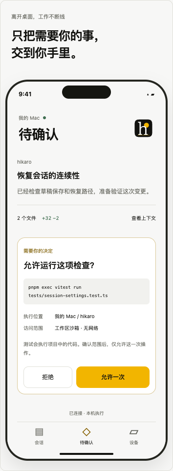

# 手机布局参考

用户已确认首版用于远程接续电脑上的任务：查看、审批、补充和停止。实施依赖和验收门槛见 [TUI／移动端路线](../../tui-mobile-direction.md)。

以下仅保留此前的手机静态截图，用于讨论待确认页面、上下文与底部导航。示例代码、命令、运行状态和授权按钮均是模拟；截图中的旧品牌也不是最终移动视觉。当前没有可交互页面、原生手机应用或生产连接。

[查看较宽的布局参考](mobile.png)。这两张截图不证明原生输入、读屏、安全存储、断网恢复、性能或耗电验收。
