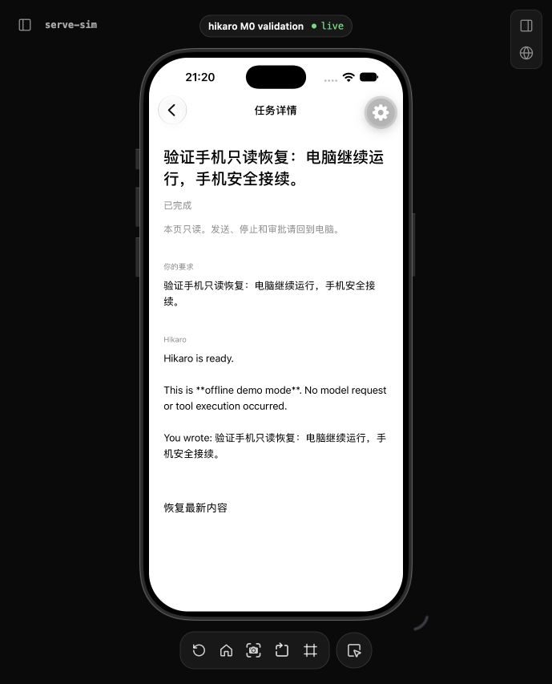
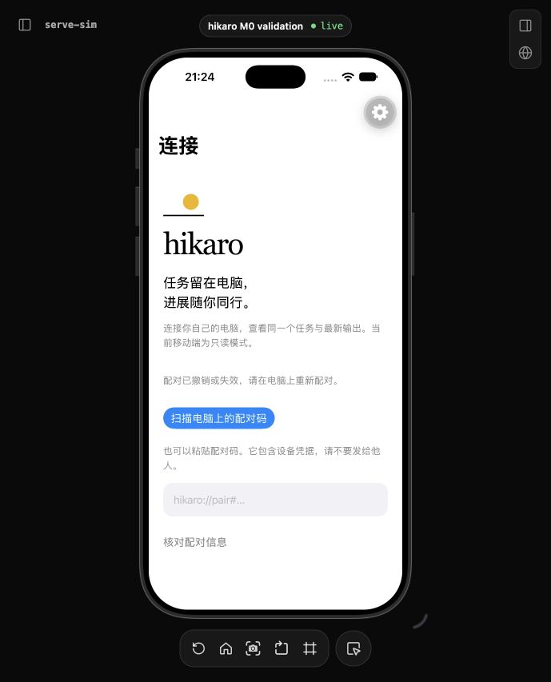

# M0 原生验证截图

2026-10-18，本地 iOS 27.0 独立测试模拟器、Expo 58 开发构建，经 serve-sim 0.1.48 在 Codex 内置浏览器操作。画面使用临时 TLS relay、真实共享 Runtime/SQLite、加密远程桥接和合成 demo 任务；不是视觉稿，也不是外部模型任务。截图不含配对凭据。

不据此宣称 iOS/Android 真机、发布版性能、真实相机扫码或商店分发已验收。启动见 [移动端指南](../../mobile.md)，完整证据见 [validation](../../validation.md)。

## 可重复的一键联调

`pnpm mobile:lab` 保留专用模拟器和私有联调数据，用于反复测试真实配对、显式授权和持久恢复。已实测模拟器剪贴板粘贴、确认后空列表、授予只读权、断线新增结果、整个环境退出再启动及原生 App 终止重开。当前证书仅信任于专用测试模拟器；没有改 macOS 或日常模拟器的证书设置，没有部署公网 relay。

[离线状态](lab-offline.png) · [完整重启后恢复任务](lab-restored.png) · [操作步骤](../../mobile-lab.md)
