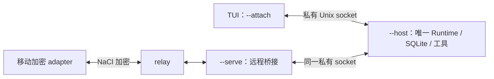

# 共享任务主机：启动、附着与恢复

更新：2026-10-19。H1 已实现并完成本地定向验证。TUI 和远程加密 adapter 可以接续同一个运行；[M0 原生手机开发客户端](mobile.md) 已支持配对、连接和只读任务恢复，真机与发布版验收仍待完成。

## 启动

先构建一次，然后在不同终端启动。所有入口必须使用相同的工作区和数据目录；路径会先规范化。以下 `/path/to/project` 替换为实际项目路径。

```sh
pnpm build

# 终端 1：执行主机。离线体验用 --demo；真实模型参数也在这里配置。
pnpm start --host --demo --cwd /path/to/project

# 终端 2：附着 TUI。任务由终端 1 的主机持有。
pnpm start --attach --cwd /path/to/project

# 终端 3：完成 relay 配对配置后，接入同一主机。
pnpm start --serve --cwd /path/to/project
```

开发时可把 `pnpm start` 换成 `pnpm dev`。默认数据目录是 `~/.hikaro`；若使用 `--home PATH`，三个入口都要指定相同路径。`--provider`、`--model`、`--base-url`、`--trust` 和 `--demo` 属于 `--host`；客户端不能覆盖已经运行的主机配置。现有 `--trust`／逐次审批政策保持原样，不自动继承独立 TUI 的权限偏好。

普通 `pnpm start` 仍是原来的独立 TUI；要接续主机任务必须明确使用 `--attach`。没有自动安装后台服务。主机没有启动、数据目录不同或 socket 权限不安全时，附着会报错，不会偷偷创建另一个执行进程。

## 两端接续与审批



手机先通过 [配对流程](remote.md) 完成主机确认，再选择主机明确授权的会话。配对不会自动授予其他会话的审批权。手机连接页显示当前设备 ID；也可从配对数据的 `deviceId` 或 `~/.hikaro/remote.json` 中 `devices` 的键获取。

在附着 TUI 内：

```text
/status                      查看会话、运行 ID、连接及未决回执
/sessions [query]            搜索并分页选择当前工作区会话
/resume [SESSION_ID]         打开选择器，或选择指定会话
/access                      查看当前会话授权
/share DEVICE_ID view        授予查看权
/share DEVICE_ID control     授予补充、停止和审批权
/share DEVICE_ID off         移除本会话访问权
```

只有本机 owner 可以改授权。设备自己创建的会话仍由该设备拥有；访问其他人的会话必须有授权。`view` 不能发送、补充、停止或审批。`control` 参与者查看同一会话时，会看到同一待批请求；任一端处理后，其他端的面板失效。主机在最终响应时重新检查授权和请求身份，同时点击也只有一次生效。正在执行的委派子任务沿用父任务审批授权，仍保留子任务自身 ID／工具详情；手动 fork 和任意历史父子关系不会自动继承控制权。停止、补充和发送请求在等待回执后若发现选中会话改变或权限撤销，会失败而不是作用到新选中的任务。

移除会话授权会关闭该设备的会话／审批视图，不会把其他参与者的请求自动拒绝。撤销整个设备则清除其会话授权与选择，取消该设备自己的运行、排队提示和尚未消费的补充；不会取消另一位 owner 正在执行的任务。已经发生的文件修改不会回滚。主机逐请求校验配对状态，并以约 1 秒间隔检查离线设备撤销。

附着视图复用现有消息、输入、`@` 文件补全和固定审批面板。支持 `/new`、`/rename`、`/fork`、`/compact`、`/steer`、`/model PROVIDER/MODEL`、`/attach PATH` 及历史分页。文件读取在本机视图准备阶段逐次确认；发送仍受 1 MiB RPC 帧和现有图片校验限制。会话、登录、模型和设置选择器已接入，资源目录可搜索和查看详情；插件命令/视图执行、`!` 手动工具与导出仍未接入。未知命令会明确提示。手动 fork／compact 创建的新会话需要重新授权；同会话自动压缩保留授权。

## 附着 TUI 核心工作流

使用本分支构建的同一版本启动 host 与附着 TUI；已经运行的旧 host 需要重启。

- `/changes`：查看当前会话记录的文件修改，阅读完整差异，明确确认后回退，再核对结果。Shell/插件编辑不在记录范围内。
- `/tasks`：查看待发消息、后台终端和直接委派的子 agent。待发消息可编辑、提前、删除；终端可查看输出、确认发送一行或停止；子任务可查看结果及确认停止。列表等待期间显示加载状态，提前按键不累积到下一页。
- `/plan TASK`：只读探索；结构化问题在面板选择或自由回答，汇总确认后提交。计划自动打开审阅，可要求修改或保持只读；批准当前版本并二次确认后才执行。`/plan` 重开审阅，`/plan cancel` 退出但不发起任务。

执行管理打开时暂停该会话待发消息派发，当前运行继续；关闭后恢复。暂停由客户端持有并定期续期；失联后最多 15 秒自动释放，已排队消息随后可能执行。停止请求不等于退出，详情以实际状态为准。

断线会关闭本地工作流面板，迟到回复不会打开旧视图。未答问题留在活着的 host，重连可重新回答；host 崩溃后不能恢复未答问题。修改命令沿用持久回执，结果不明时核对当前状态和回执，不自动重发。host 采用明确保存的工作区权限设置；没有保存设置时保留原有审批规则。

完整证据与限制见 [附着核心流程验收](validation/tui-parity.md)。会话/登录/模型/设置与资源目录的后续交付见 [导航验收](validation/attached-navigation.md)。

## 会话、登录与设置

| 入口                                                            | 操作                                                                                                                               |
| --------------------------------------------------------------- | ---------------------------------------------------------------------------------------------------------------------------------- |
| `/sessions [query]`、`/resume`                                  | 搜索当前工作区所有会话，翻页；Enter 切换，Ctrl+R 改名，Delete 删除并确认。Ctrl+D 始终退出附着视图，不用于删除。                    |
| `/model`                                                        | 搜索选择模型；Enter 应用于当前会话，Ctrl+S 同时保存为新会话默认。仍支持 `/model provider/model`。                                  |
| `/login`                                                        | 选择 provider 和认证方式；密钥输入隐藏，OAuth 按原流程打开本机浏览器。Esc 取消。凭据留在同一 home 对应的系统钥匙串，不发送到 RPC。 |
| `/context [default]`、`/thinking [default]`、`/speed [default]` | 面板只列支持的值；可切换 active/default，保存 default 不更改当前会话。当前附着版不接受数值快捷参数，使用菜单选择。                 |
| `/settings`                                                     | 保存当前工作区、当前 `--client-id` 的显示/提示/启动偏好。重开生效；显式 `--session` / `--new` 优先于启动偏好。                     |
| `/permissions`                                                  | 修改 host 工作区权限，影响该工作区的任务。仅本机 owner 可用；有任务运行时拒绝。                                                    |
| `/resources [query]`                                            | 查看 host 已加载的 Skill、指令路径、工具说明和插件入口状态，支持搜索与翻页。不是安装器或插件执行器；配置变更需重启 host。          |

登录成功后刷新 host 目录，再选模型；认证保存与模型切换是两个步骤，取消模型选择不撤销刚保存的登录。另一台设备不能通过这些接口改 host 登录、权限或全局默认值。外部账号、OAuth 回调和系统钥匙串授权弹窗需实际环境验收，自动验证使用隔离凭据存储。

## 退出和重启

| 操作                                   | 结果                                                               |
| -------------------------------------- | ------------------------------------------------------------------ |
| 附着 TUI 按 Ctrl+D，包括审批面板打开时 | 保存本地草稿、退出视图；任务和待批请求继续留在主机                 |
| 工作中按 Ctrl+C                        | 停止当前选中的任务；审批面板内沿用原来的拒绝键行为                 |
| 手机断网、锁屏或退出                   | 不取消任务；恢复后先 hello、快照和回执核对，不重发变更             |
| 同身份再次附着                         | 新视图接管，旧连接被隔离并停止自动重连；多视图用不同 `--client-id` |
| 关闭 `--serve`                         | 关闭远程桥接；主机与本机 TUI 继续运行                              |
| 主机终端按 Ctrl+C                      | 主机取消工作并关闭；重新启动后恢复已保存历史、选择和授权           |
| 主机被强制结束                         | 重启后未完成运行标为 unknown，不宣称仍在执行，也不自动补发         |

附着 TUI 默认身份是 `main`。同时开第二个视图用 `pnpm start --attach --client-id review --cwd /path/to/project`。同身份重开恢复自己的选择和草稿，不覆盖其他视图草稿。

本机 socket 丢失后按 200 ms 至 5 s 的有界退避重新连接；每次重新校验私有元数据。主机重启仍使用上面的第一条命令，客户端随后自动重建连接。`/reconnect` 可以显式重做已连接通道的握手和回执核对；它不会创建主机或重发原命令。

本地意图文件只保存未决命令 ID／方法，发送前先持久提交；正文和参数不进入意图账本。应用重开后先查询回执；没有回执也保留 unknown，不能当作“安全重试”。草稿是独立的本地未发送内容，按原 300 ms 保存窗口合并；强制结束前最后一个窗口仍可能丢失。移动端通过 `IntentStore` 接入有界 SQLite 意图账本和系统凭据存储；开发构建已验证模拟器重开恢复，真机与发布版验收仍待完成，见 [M0 指南](mobile.md)。

## 验证和边界

真实 Unix socket + Runtime + SQLite、加密设备 adapter 和真实 PTY 已覆盖共享运行、审批竞争、撤权、断线、视图重建与主机强制崩溃恢复。provider 和 relay/socket 网络部分使用确定性 fixture；未连接外部模型、生产 relay 或手机真机。

原独立 TUI 的 200 ms／16 ms／100 MiB 门槛和 10k harness 保留。附着视图另测 30 次 warm-host 启动，同时报告 host 与双进程合计 RSS，不能把界面进程的内存当作整个共享模式开销。数据见 [性能记录](harness-performance.md)，接口边界见 [H1 契约](specs/shared-host.md)。
