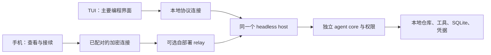

# Hikaro：TUI 与移动端路线

2026-10-18 确认路线，2026-10-23 核对实现状态。现有 TUI 为主要编程界面，手机远程接续电脑上的任务，聚焦查看、审批、补充和停止。Expo/React Native 原生客户端及共享 host/relay 已实现；iOS 模拟器已有核心流程验收，Android 已构建自用 APK，双平台真机与生产网络仍待验收。此文保留产品分工与完成条件，逐项证据见 [两端完成度审计](validation/completion-audit-2026-10-23.md)。

## 产品分工

TUI 是电脑上的主工作界面：输入任务、文件引用、代码与 diff 阅读、模型配置、工具授权、验证和 Git 工作流。现有全屏 TUI 已有实际实现，继续补齐日常使用缺口，无需重新选择终端框架。

移动端是连接自己的电脑的原生客户端：已实现查看任务与输出、确认完整工具请求、补充要求和停止任务；图片与 diff 已接入，通知继续按基本检查和实际收件分项推进。电脑上的 host 持有仓库、凭据、工具和执行权。手机锁屏、断网或退出不应中断 host，也不能在恢复时自动重发变更命令。

H1 已实现这条共享链：`--host` 持有 Runtime，`--attach` TUI 与 `--serve` 加密桥接连接同一私有 IPC。普通 TUI 仍保留原来的独立启动路径；必须明确附着才能跨端接续。已有真实 Runtime/SQLite/Unix socket、加密 adapter 和真实 PTY 的本地验证；手机原生 UI 已通过加密 adapter 连接这条链，支持查看、审批、发送、steering 与停止；真机/生产 relay 验收仍开放。启动与重启见 [共享主机指南](shared-host.md)。

[手机布局参考](design/mobile-controller/README.md) 是此前保存的纯移动静态截图；不能作为当前原生实现或最终视觉的证据。

## 路线比较

| 方案                      | 能解决什么                         | 主要代价                                                                               | 判断                             |
| ------------------------- | ---------------------------------- | -------------------------------------------------------------------------------------- | -------------------------------- |
| 现有 TUI + 原生移动控制器 | 电脑深入工作，离开电脑后查看与接续 | 同一 host 的接入、安全配对、原生后台恢复                                               | 推荐主线                         |
| 手机 SSH 连接 TUI         | 可尽快使用现有终端体验             | 小屏、触控、中文输入、图片与审批交互受终端客户端影响                                   | 可选临时用法，不算原生移动交付   |
| 手机独立运行现有 agent    | 不依赖在线电脑                     | 需要替换 Node、子进程、PTY、文件沙箱、native helper 与凭据实现；另做设备端仓库执行体系 | 独立产品范围，本轮不承诺         |
| PWA / WebView 界面        | 可以验证页面及部分协议体验         | 安全存储、相机、通知和后台恢复还需平台验证                                             | 不作为已经完成原生移动能力的证据 |

## 已有基础与实际缺口

已有：全屏 TUI、文件/图片输入与 `@` 补全、草稿、自动压缩、权限面板、持久化会话与回执；可移植状态归并；Node 本地传输；配对、加密、设备 scope 与撤销原型。本轮共享连接层已接入远程原始帧，提供有界请求、超时、恢复快照和回执核对；会话元数据、模型、草稿、消息/图片分段与受限工件读取也已有协议入口。

本地与远程适配已用同一个真实 CLI + SQLite 验证：通知重复/缺口、回复丢失、重连和回执核对。加密通道是真实实现，socket/relay 链路是进程内 fixture，**不等于真实网络或移动真机验收**。

当前已实现与剩余验收：

- M0 原生配对页、SecureStore 凭据、SQLite 意图/草稿、随机源、重连与撤销边界已实现，并有 iOS 模拟器和实际 host 回归。iOS/Android 真机的相机、存储、网络切换、锁屏及进程恢复仍待验收。
- M1 审批、按运行停止、发送/待发队列和 steering 已实现；iOS 模拟器已验证关键操作及终态。跨真实 relay 的手机接续任务、Android 原生运行和完整输入法仍缺证据。
- M2 图片/diff 已有 iOS 原生验收；全文搜索与有界离线历史缓存已有控制器/实际 host 证据，原生搜索和缓存重开待验。通知已有注册/关闭入口及原生模块，点击状态复核、生产收件与真机后台验收继续开放。手机向任务添加图片尚无交付证据，不把图片阅读当作图片选择/上传完成。
- TUI 已交付当前会话全文搜索、图片可移植导出、macOS 剪贴板图片、回退后 redo、附着模型参数及持久待发/steering 恢复。工具输出阅读、通用附件导出、批量回退/按轮聚合、嵌套任务树、计划进度、真实摘要质量、跨重启预算和完整 Pi/资源兼容仍需逐项推进；实现及待验边界见 [成品收尾](../tasks/todo.md)和 [TODO](../TODO.md)。

## 分阶段完成条件

| 阶段                             | 实际交付                                                         | 通过条件                                                                     |
| -------------------------------- | ---------------------------------------------------------------- | ---------------------------------------------------------------------------- |
| H1 同一 host（已实现，本地验证） | TUI 的可选附着模式、本地安全传输、明确启停、跨端审批策略         | 真实 TUI 与第二客户端查看同一运行；断开任一界面不重复执行；host 崩溃状态可见 |
| M0 原生连接实验                  | Expo 开发构建、扫码/主机确认、密钥存储、只读会话与输出、快照恢复 | iOS/Android 真机能连接；断网、锁屏、杀进程、撤销后正确恢复或拒绝             |
| M1 移动任务闭环                  | 完整审批页、查看、补充/取消、未发送草稿、回执核对                | 一次真实主机任务跨端接续；旧审批失效；未知命令绝不自动重发                   |
| M2 扩展与发布                    | 图片/diff、通知深链、缓存管理、辅助技术、耗电测量、签名分发      | 发布构建与真机测量通过；通知丢失不影响任务事实                               |

M0/M1/M2 的部分实现已并行交付，不代表前一阶段的真机门槛自动通过。实现与启动见 [移动端指南](mobile.md)，原生安装见 [安装说明](mobile-install.md)。iOS 核心操作已有模拟器证据，Android 自用 APK 已构建；双平台真机、生产 relay 和发布性能仍未完成。H1 加密 fixture 不能替代这些验收。

## 主机与设备边界

- 配对码有效期 5 分钟，包含设备凭据；主机人工确认新设备、固定对端 key 并执行双向 challenge。不能把配对 URI、模型密钥、正文或命令写进推送和诊断。
- 复用现有 NaCl 加密、方向和序号验证。relay 仍可看到连接元数据和密文长度；现协议不承诺前向保密，不临时拼装新的加密算法。
- 客户端只能选择主机明确授权的项目。移动端不提供任意主机 cwd、凭据登录或提高权限的入口；provider 首次登录与 endpoint 配置留在主机。
- H1 采用会话显式授权：本机 owner 管理 view/control，只有查看该会话的 control 参与者收到审批；请求仍保留发起 scope，host 在回应时重查授权和请求身份，竞争只生效一次。普通 stdio RPC 保留原严格 scope 隔离。
- 断线后只重试安全读取；超时/未确认变更先核对持久回执。离线草稿仍未发送，重连或应用重开不自动发送。客户端必须在发送前持久保存命令 ID，移动缓存按 relay、host、公钥与 device 隔离，草稿另按任务隔离。
- 撤销设备时清除本机密钥与缓存并锁定页面；当前 host 撤销还会取消该 scope 的 active run，要明确展示这一结果。它不能撤回已经发生的文件修改。
- 当前移动端每个配对身份仅持久保存最近查看的一页，最多 20 条、单条预览 20,000 字符、序列化总长 2,000,000 字符；图片与完整附件不缓存。完整内容按需分页，离线快照不恢复权限，见 [缓存边界](validation/mobile-offline-history.md)。权限详情不能因窄屏或大文字被截断。锁屏不直接批准，从通知打开后仍须重取权威状态。

## 技术选择与性能约束

当前使用 TypeScript；移动 UI 使用 Expo + React Native。复用协议、归并与故障语义，按平台实现输入、导航、列表和安全存储。密钥使用系统安全存储，历史与草稿使用有界缓存；不把完整历史塞进密钥存储。Expo 文档明确说明 SecureStore 存在平台大小限制及卸载/备份差异。[SecureStore](https://docs.expo.dev/versions/latest/sdk/securestore/)

随机源通过 `setRandomSource` 注入 Expo 平台加密随机数；iOS 原生连接已有验收，Android 和真机仍需核对运行行为。[Expo Crypto](https://docs.expo.dev/versions/latest/sdk/crypto/)

手机回到前台后重新取得权威快照。通知只提示“有进展/需要确认”，不带代码或授权结果；系统不保证后台投递与执行。[Expo 通知边界](https://docs.expo.dev/push-notifications/what-you-need-to-know/)

TUI 时间门槛保持：3 次预热后 30 次启动，p95 ≤200 ms、输入 p95 ≤16 ms、流式增量 p95 ≤33 ms；SQLite FULL、native 文件防护及 10k harness 断言不变。内存按 [2026-10-21 修订口径](specs/shared-memory-soak.md)记录平台 footprint/PSS 和工作负载趋势，旧 100 MiB RSS 上限只保留为历史参考，不再作为独立或共享模式未经论证的发布硬门槛。[性能记录](harness-performance.md)与[完整 30 分钟记录](validation/shared-memory-soak.md)保留当时构建和环境，不外推为当前包或手机通过。

移动性能沿用原方案门槛：发布构建启动 p95 ≤1.8 s、输入 p95 ≤16 ms、事件到可见增量 p95 ≤50 ms、应用 footprint ≤140 MiB、30 分钟预热后增长 ≤10%。消息分页、列表虚拟化和流式合并分别控制读取、渲染与刷新成本；不能只开虚拟列表就宣称缓存已受限。[React Native 列表说明](https://reactnative.dev/docs/optimizing-flatlist-configuration)

只为实际风险增加必要测试：协议/归并契约、一条真实 host 链、权限与未知命令负向用例；平台生命周期用真机验证。测试通过、性能达标、真实产品验收分别记录。
