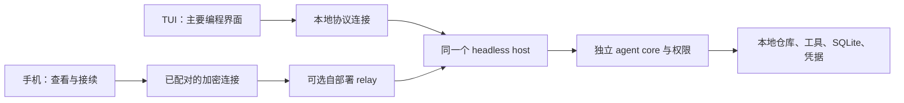

# Hikaro：TUI 与移动端路线

2026-10-18。用户已确认：现有 TUI 为主要编程界面，手机远程接续电脑上的任务，首版聚焦查看、审批、补充和停止。以下框架选择与实现细节仍是建议；原生移动应用与服务部署尚未开始。

## 建议的产品分工

TUI 是电脑上的主工作界面：输入任务、文件引用、代码与 diff 阅读、模型配置、工具授权、验证和 Git 工作流。现有全屏 TUI 已有实际实现，继续补齐日常使用缺口，无需重新选择终端框架。

移动端是连接自己的电脑的原生客户端：先完成查看任务与输出、确认完整工具请求、补充要求和停止任务；图片、diff 和通知再逐项推进。电脑上的 host 持有仓库、凭据、工具和执行权。手机锁屏、断网或退出不应中断 host，也不能在恢复时自动重发变更命令。

这是目标架构。**当前 TUI 直接创建 Runtime；`--serve` 另开一个 RPC 执行进程。二者尚未附着同一个 host，不能把分别启动它们当成跨端接续。** 会话租约可阻止部分重复执行，但不负责共享流式状态、审批和生命周期。

[手机布局参考](design/mobile-controller/README.md) 是此前保存的纯移动静态截图；不能作为当前原生实现或最终视觉的证据。

## 路线比较

| 方案                      | 能解决什么                         | 主要代价                                                                               | 判断                             |
| ------------------------- | ---------------------------------- | -------------------------------------------------------------------------------------- | -------------------------------- |
| 现有 TUI + 原生移动控制器 | 电脑深入工作，离开电脑后查看与接续 | 同一 host 的接入、安全配对、原生后台恢复                                               | 推荐主线                         |
| 手机 SSH 连接 TUI         | 可尽快使用现有终端体验             | 小屏、触控、中文输入、图片与审批交互受终端客户端影响                                   | 可选临时用法，不算原生移动交付   |
| 手机独立运行现有 agent    | 不依赖在线电脑                     | 需要替换 Node、子进程、PTY、文件沙箱、native helper 与凭据实现；另做设备端仓库执行体系 | 独立产品范围，本轮不承诺         |
| PWA / WebView 界面        | 可以验证页面及部分协议体验         | 安全存储、相机、通知和后台恢复还需平台验证                                             | 不作为已经完成原生移动能力的证据 |

## 已有基础与实际缺口

已有：全屏 TUI、文件/图片输入与 `@` 补全、草稿、自动压缩、权限面板、持久化会话与回执；可移植状态归并；Node 本地传输；配对、加密、设备 scope 与撤销原型。本轮共享连接层已接入远程原始帧，提供有界请求、超时、恢复快照和回执核对；会话元数据、模型、草稿、消息/图片分段与受限工件读取也已有协议入口。

本地与远程适配已用同一个真实 CLI + SQLite 验证：通知重复/缺口、回复丢失、重连和回执核对。加密通道是真实实现，socket/relay 链路是进程内 fixture，**不等于真实网络或移动真机验收**。

仍需完成：

- TUI 接入共享 host；启动/附着/停止归属、本地 IPC 的权限与认证、host 崩溃后的明确恢复，以及手机与 TUI 的审批归属规则。
- 客户端命令意图在发送前持久保存，按 host/workspace/device 隔离；应用被杀后仍保留未知命令 ID。host 已有持久回执，不代表客户端本地意图账本也已交付。
- Expo/React Native 的真实打包验证：现有连接层源文件没有 Node 导入，但 crypto 仍使用 Web 编码 API，TweetNaCl 的平台解析和 Hermes 下随机源必须实测。不能以 TypeScript 检查替代原生可运行性。
- 原生配对页、设备密钥存储、重连/撤销、离线缓存、图片选择、通知与双平台真实设备验收。
- TUI 的 diff/长输出阅读、消息全文搜索、剪贴板图片、真实摘要质量、跨重启预算与待发队列恢复；已有实现与待验收边界继续见 [TODO](../TODO.md)。

## 分阶段推进建议

| 阶段            | 实际交付                                                         | 通过条件                                                                     |
| --------------- | ---------------------------------------------------------------- | ---------------------------------------------------------------------------- |
| H1 同一 host    | TUI 的可选附着模式、本地安全传输、明确启停、跨端审批策略         | 真实 TUI 与第二客户端查看同一运行；断开任一界面不重复执行；host 崩溃状态可见 |
| M0 原生连接实验 | Expo 开发构建、扫码/主机确认、密钥存储、只读会话与输出、快照恢复 | iOS/Android 真机能连接；断网、锁屏、杀进程、撤销后正确恢复或拒绝             |
| M1 移动任务闭环 | 完整审批页、查看、补充/取消、未发送草稿、回执核对                | 一次真实主机任务跨端接续；旧审批失效；未知命令绝不自动重发                   |
| M2 扩展与发布   | 图片/diff、通知深链、缓存管理、辅助技术、耗电测量、签名分发      | 发布构建与真机测量通过；通知丢失不影响任务事实                               |

M0 可以先用独立 `--serve` host 验证连接，但必须在 H1 完成后，才声称手机能接续正在 TUI 中执行的任务。先讨论并固定这条边界，再安装移动依赖和写屏幕。

## 主机与设备边界

- 配对码有效期 5 分钟，包含设备凭据；主机人工确认新设备、固定对端 key 并执行双向 challenge。不能把配对 URI、模型密钥、正文或命令写进推送和诊断。
- 复用现有 NaCl 加密、方向和序号验证。relay 仍可看到连接元数据和密文长度；现协议不承诺前向保密，不临时拼装新的加密算法。
- 客户端只能选择主机明确授权的项目。移动端不提供任意主机 cwd、凭据登录或提高权限的入口；provider 首次登录与 endpoint 配置留在主机。
- 跨端审批需要明确“同一会话的已授权参与者”或显式转交策略。现有审批严格绑定发起 scope，不能为实现手机批准而绕过 scope 检查；host 对过期、已处理、撤销和竞态作最终判断。
- 断线后只重试安全读取；超时/未确认变更先核对持久回执。离线草稿仍未发送，重连或应用重开不自动发送。客户端必须在发送前持久保存命令 ID，缓存按 host/workspace/device 隔离。
- 撤销设备时清除本机密钥与缓存并锁定页面；当前 host 撤销还会取消该 scope 的 active run，要明确展示这一结果。它不能撤回已经发生的文件修改。
- 初始历史缓存上限沿用 50 MiB、可见消息不超过 200，完整内容按需分页；权限详情不能因窄屏或大文字被截断。锁屏不直接批准，从通知打开后重取权威请求。

## 技术选择与性能约束

建议继续 TypeScript；移动 UI 候选为 Expo + React Native。复用协议、归并与故障语义，按平台实现输入、导航、列表和安全存储。密钥使用系统安全存储，历史与草稿使用有界缓存；不把完整历史塞进密钥存储。Expo 文档明确说明 SecureStore 存在平台大小限制及卸载/备份差异。[SecureStore](https://docs.expo.dev/versions/latest/sdk/securestore/)

随机源可通过现有 `setRandomSource` 注入平台加密随机数；接入顺序、编码兼容及加密 fixture 必须在原生运行时验证。[Expo Crypto](https://docs.expo.dev/versions/latest/sdk/crypto/)

手机回到前台后重新取得权威快照。通知只提示“有进展/需要确认”，不带代码或授权结果；系统不保证后台投递与执行。[Expo 通知边界](https://docs.expo.dev/push-notifications/what-you-need-to-know/)

原 TUI 门槛保持：30 次启动 p95 ≤200 ms、输入 p95 ≤16 ms、就绪 RSS ≤100 MiB；SQLite FULL、native 文件防护及 10k harness 断言不变。最终构建启动 p95 174.02 ms，输入 1.765 ms、RSS 70.86 MiB；10k harness 原门槛均通过。完整运行条件见 [性能记录](harness-performance.md)，不能外推到手机。

移动性能沿用原方案门槛：发布构建启动 p95 ≤1.8 s、输入 p95 ≤16 ms、事件到可见增量 p95 ≤50 ms、应用 footprint ≤140 MiB、30 分钟预热后增长 ≤10%。消息分页、列表虚拟化和流式合并分别控制读取、渲染与刷新成本；不能只开虚拟列表就宣称缓存已受限。[React Native 列表说明](https://reactnative.dev/docs/optimizing-flatlist-configuration)

只为实际风险增加必要测试：协议/归并契约、一条真实 host 链、权限与未知命令负向用例；平台生命周期用真机验证。测试通过、性能达标、真实产品验收分别记录。
