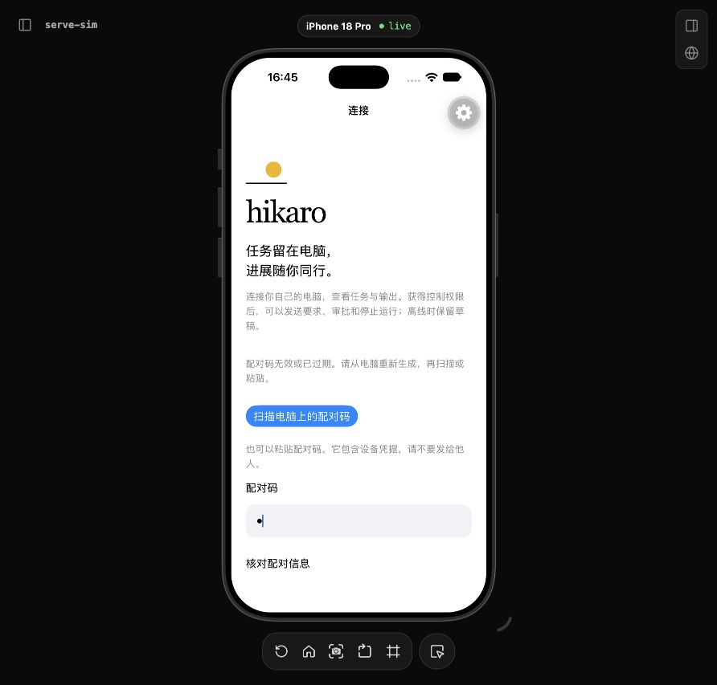
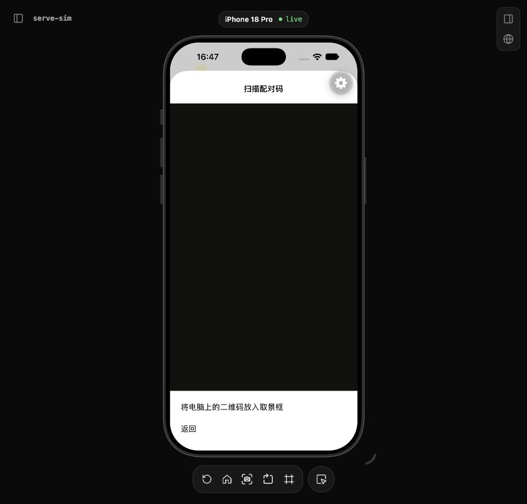

# 手机连接移除与扫码失败恢复 · 2026-10-23

## 问题与修改

连接页（包括恢复中、离线与错误状态）和任务列表此前直接调用 `controller.forget()`。一次误触就会移除本机配对、未发送草稿和历史缓存，没有让用户核对清理范围。现在统一打开系统确认框，明确这些后果；选择“保留连接”或取消弹窗不会调用清理。配对信息审阅页的“取消”仍只用于取消尚未保存的配对审阅流程。

确认绑定打开弹窗时的配对身份。复用控制器已有的身份代际与配对 scope，不把通知内容作为身份依据。确认期间原身份被替换时拒绝旧确认，并要求重新查看连接；同一身份的普通状态刷新不阻断确认。恢复初始或凭据损坏等没有身份的状态，绑定当时的状态对象；状态变化后需要重新确认。单个确认在调用存储前就被消费，重复回调不会再删除，失败也不会自动重试。

扫码页新增相机启动失败处理：不再只停留在无法工作的预览，显示通用错误，允许重新打开相机或返回粘贴配对码。权限请求失败会捕获异常并显示同样明确的退路，不输出原始系统错误或二维码内容，不修改系统权限。权限/启动失败页使用可滚动容器，避免大字体或小屏下的底部返回操作被固定布局挡住；完整大字体与读屏可用性仍须原生验收。

连接恢复页补充“重连不自动发送”和移除后果说明；配对安全输入保留原有原生控件与隐藏内容行为，增加可见“配对码”标签，连接指示器增加读屏描述。当前 `@expo/ui` universal TextInput 未提供通用 `accessibilityLabel`/`accessibilityHint` 参数，本次没有据可见标签宣称安全输入的 VoiceOver/TalkBack 验收通过。全局按钮固定高度未在本次修改，仍需实际大字裁剪检查。

## 本轮验证

- `pnpm exec vitest run tests/mobile-connection-removal.test.ts`：6 项通过。先添加测试时因保护模块尚不存在而失败，再实现后通过；不把缺模块失败描述为原生误触复现。
- 用例覆盖：取消后保留；存储尚未完成时重复确认只清理一次；断线并更换身份后的旧确认拒绝；同身份状态刷新仍可确认；空身份的状态变更拒绝；清理失败不通过原确认自动重试。
- `pnpm mobile:typecheck`：通过。
- 以上测试验证清理保护逻辑，不验证原生弹窗事件顺序、真实相机、系统权限弹窗或读屏表现。未运行全量测试、性能基准或新的 Android 构建。

## 移除期间切后台的恢复缺陷

独立复查发现旧控制器的一个实际竞态：配对清理尚未完成便切到后台，后台生命周期使 `forget()` 原先的页面更新失效。存储清理成功后，前台恢复读到空凭据并显示未配对页面，却仍保留旧的内存 `pairing`，再次粘贴/扫码被 `Remove the current pairing first` 拒绝。

新增回归先通过现有加密 fixture 建立连接，挂起真实控制器调用的存储清理，再执行后台、完成清理、前台恢复及重新配对。修改前在重新 `review` 时精确失败；现在 `restore()` 读到空凭据且代际仍有效时，清理旧内存身份、失效旧草稿代际并解绑编辑器，再显示未配对。此分支不额外删除存储；已有凭据串行队列与异步结果代际检查继续生效。

修改后 `pnpm exec vitest run tests/mobile-controller.test.ts tests/mobile-connection-removal.test.ts` 共 28 项通过，包含前述 6 项移除保护用例、控制器既有实际 shared host 恢复和新回归；不能把重叠的两次运行相加成独立用例。移动类型检查再次通过。新回归还验证空凭据恢复不发送网络请求、重新配对后身份不同且连接成功。

## 原生状态与待验

使用原有 iPhone 18 Pro / iOS 27 模拟器及 `localhost:3200` 预览，无新设备、CA 或权限变更。连接页正常显示新“配对码”标签；逐键输入无效码 `a` 后点核对，显示无效或过期提示；进入扫码页后点“返回”可回连接页。桥接 `typeText` 未输入正文，后续采用逐键并检查实际画面，不将浏览器调用成功等同原生输入成功。

扫码页实测发现导航标题黑字落在黑色取景区，补充该路由的系统背景与标签颜色；热更新后标题清楚可见。当前模拟器取景区是黑色，没有验证真实相机扫码或主动触发启动失败。

仍待原生验收：权限请求失败、相机启动失败后的重试/粘贴；连接移除取消后草稿仍在、确认清理及重配对；两处移除入口的弹窗与大字体。上述清理期间切后台的竞态通过代码回归，不替代真机生命周期操作。Android、真机相机、VoiceOver/TalkBack 和系统最大字号仍待验收。

接口依据：[React Native Alert](https://reactnative.dev/docs/alert)、[Expo Camera](https://docs.expo.dev/versions/latest/sdk/camera/)；同时核对本机 Expo 58 的 `CameraView.onMountError`、权限请求返回类型及 universal TextInput 类型。没有新增依赖。
