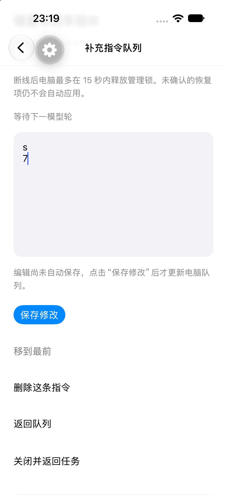

# 移动端原生回车验收

2026-10-21，基线 4378c46；iPhone 18 Pro / iOS 27 模拟器，经 Codex 内置浏览器连接 serve-sim 0.1.48。隔离 host 使用 demo/offline，没有调用真实模型。

## 问题与修改

Expo UI 58.0.20 的 universal TextInput 在 iOS 包装 SwiftUI TextField。原组件接收普通字符，但 Return 没有保留换行，随后字符未进入草稿，前一个字符还出现回退。任务输入框及 steering 编辑框改用 React Native 原生多行 TextInput，明确 submitBehavior="newline"，直接使用 controller 的受控文本；发送和保存仍由独立按钮执行。

## 通过的检查

- 逐键验收 Return、后续字符、BackSpace；独立读取手机 SQLite，换行与草稿一致。
- Return 不发送；点击发送前 host 只有初始用户消息，点击后恰好新增一条 `probe\n2x4\n6`，与本机草稿逐字相同。
- steering 原生输入 `s`、Return、`7`，点击保存后重开仍为两行。
- mobile typecheck、iOS/Android Hermes export、既有 composer/steering 两个测试文件共 12 项通过。

## 仍需验收

软件键盘、中文候选输入、Android 与真机没有在本轮验收。快速连续桥接按键曾得到与预期不符的结果，尚未区分桥接事件顺序与应用问题；逐键落盘核对通过不替代高速输入验收。完整键盘门槛保持未完成。结构化记录见 [mobile-keyboard.json](mobile-keyboard.json)。

## 连续编辑定位补充

336970d 后新增慢存储回归：旧写入已开始且被挂起时，连续编辑中文、换行、emoji、退格后的内容；分别让旧写入成功或失败，验证整个通知过程没有旧文本回跳，最终存储和重新读取均保留最新原文。controller 回归另验证每次编辑同步通知订阅者，且不产生网络请求。composer/controller 两文件 20 项通过，根项目类型检查通过。

serve-sim 0.1.48 的 `src/native.ts` 将 key 暴露为 Promise；分发服务的按键分支调用 `this.hid.key(G.type,G.usage)` 而未等待。Swift `sim-module.swift` 跨 actor 调用 HIDInjector，legacy 路径的 rawSend 未传 completion 回调。由此不能把浏览器 pressKey 返回等同于手机编辑完成；这是需要隔离验证的桥接因素，并非已证明的唯一根因。上述测试只排除了所覆盖的草稿/controller 路径，不替代原生高速输入和 IME 验收。
